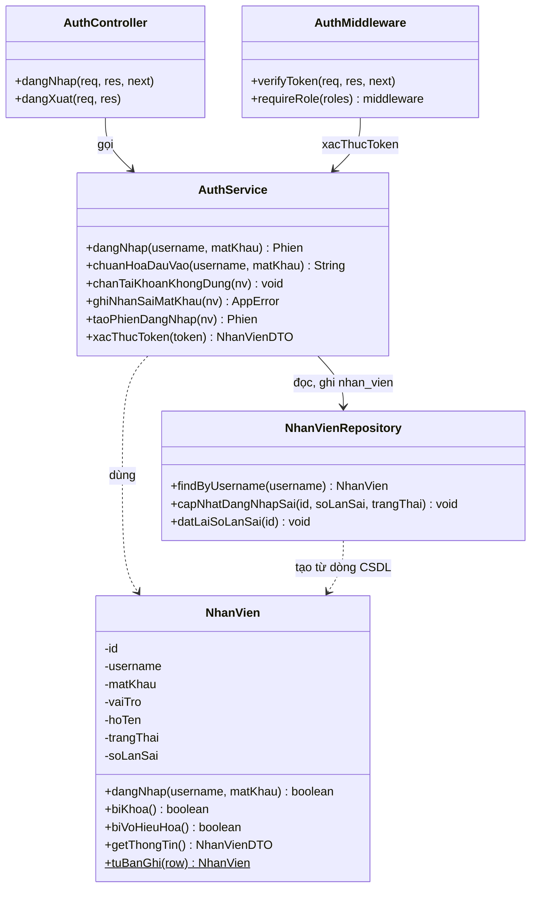

# Class Diagram – UC21 Đăng nhập

Kiến trúc 3 tầng: `AuthController` (nhận request) gọi `AuthService` (luật đăng nhập), `AuthService` dùng `NhanVienRepository` (đọc, ghi bảng `nhan_vien`) và lớp `NhanVien`. Mọi API khác kiểm tra đăng nhập qua `AuthMiddleware` (`verifyToken`, `requireRole`).

Đối chiếu code: `src/controllers/AuthController.js`, `src/services/AuthService.js`, `src/models/NhanVien.js`, `src/repositories/NhanVienRepository.js`, `src/middlewares/auth.js`.

## Đối chiếu với code

| Lớp | Phần tử | File | Dòng |
|---|---|---|---|
| AuthController | `dangNhap`, `dangXuat` | `src/controllers/AuthController.js` | 25, 37 |
| AuthService | `chuanHoaDauVao`, `chanTaiKhoanKhongDung` | `src/services/AuthService.js` | 26, 34 |
| AuthService | `ghiNhanSaiMatKhau`, `taoPhienDangNhap` | `src/services/AuthService.js` | 40, 49 |
| AuthService | `dangNhap`, `xacThucToken` | `src/services/AuthService.js` | 57, 73 |
| NhanVien | `dangNhap` (so mật khẩu bcrypt), `biKhoa`, `biVoHieuHoa`, `getThongTin` | `src/models/NhanVien.js` | 40, 45, 49, 54 |
| NhanVienRepository | `findByUsername`, `capNhatDangNhapSai`, `datLaiSoLanSai` | `src/repositories/NhanVienRepository.js` | 17, 23, 28 |
| AuthMiddleware | `verifyToken`, `requireRole` | `src/middlewares/auth.js` | 16, 29 |

## Ghi chú

- Lớp `NhanVien` theo Class Diagram gốc gồm `id`, `username`, `matKhau`, `vaiTro`, `dangNhap()`, `getThongTin()`. Bổ sung cho UC21: `hoTen`, `trangThai` (HOAT_DONG, BI_KHOA, VO_HIEU), `soLanSai`, `biKhoa()`, `biVoHieuHoa()`.
- `matKhau` là bản băm bcrypt, không bao giờ trả ra ngoài. `getThongTin()` chỉ trả `nhanVienId`, `hoTen`, `vaiTro`.
- Sai mật khẩu 5 lần liên tiếp (`SO_LAN_SAI_TOI_DA`) thì `trangThai` chuyển sang `BI_KHOA`.
