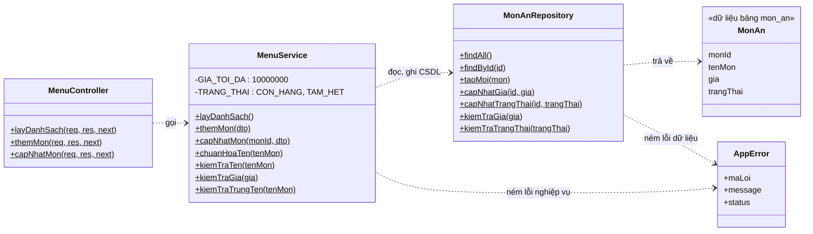
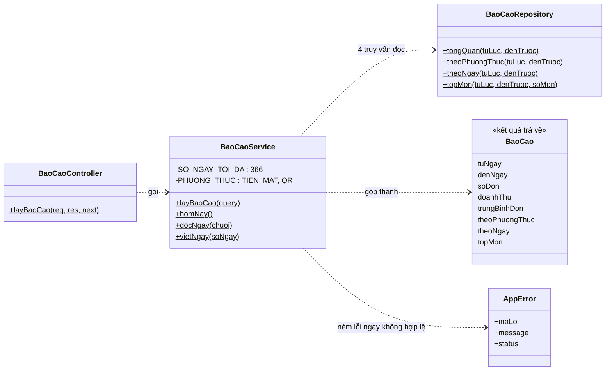

# Class Diagram – UC22 Quản lý menu và UC24 Báo cáo doanh thu

Các lớp dưới đây đều chỉ có phương thức `static` (gọi trực tiếp qua tên lớp, không cần tạo đối tượng). Ký hiệu `$` sau tên phương thức nghĩa là `static`. Phụ thuộc đi một chiều **Controller → Service → Repository**, tầng trên không bỏ qua tầng dưới.

Đối chiếu code: `src/controllers/`, `src/services/`, `src/repositories/`, `src/utils/AppError.js`.

## 1. UC22 – Quản lý menu

Phân công trách nhiệm:
- **MenuController**: nhận request, lấy `req.body`, `req.params`, gọi Service rồi trả response chuẩn. Không chứa luật nghiệp vụ.
- **MenuService**: giữ luật của quán (tên 1–100 ký tự, giá nguyên 1 đến 10.000.000, không trùng tên, trạng thái chỉ `CON_HANG` hoặc `TAM_HET`). Không viết SQL.
- **MonAnRepository**: nơi duy nhất viết SQL cho bảng `mon_an`.

## 2. UC24 – Báo cáo doanh thu

Phân công trách nhiệm:
- **BaoCaoController**: lấy `req.query`, gọi Service, trả response chuẩn.
- **BaoCaoService**: kiểm tra khoảng ngày, đổi sang hai mốc giờ, chạy 4 truy vấn cùng lúc rồi gộp thành báo cáo. Có hàm phụ `homNay`, `docNgay`, `vietNgay` để xử lý ngày.
- **BaoCaoRepository**: chỉ **đọc** bảng `thanh_toan`, `chi_tiet_don`, `mon_an`. UC24 không ghi gì vào CSDL.

## Điểm chung của hai UC
Cả hai dùng chung `AppError(maLoi, message, status)`. Service ném lỗi này, `errorHandler` đổi thành response chuẩn `{ success: false, data: null, maLoi, message }`. Hai lớp `MonAn` và `BaoCao` là dạng dữ liệu (object thuần), trong code không có `class` riêng cho chúng.
