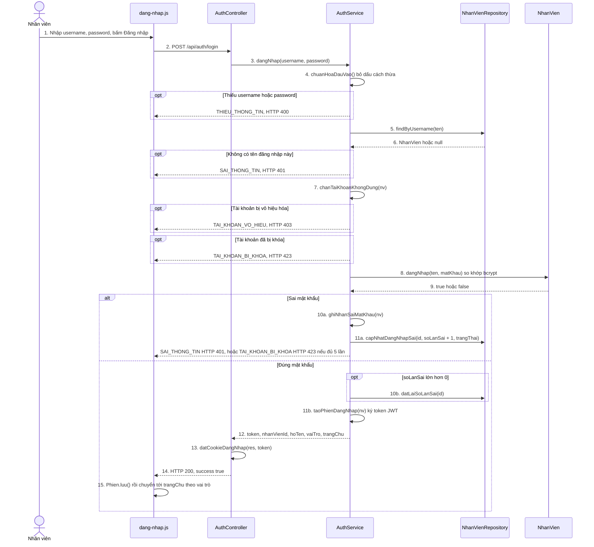

# Sequence Diagram – UC21 Đăng nhập

Người thực hiện: nhân viên (Phục vụ, Barista, Thu ngân, Chủ quán). Mã lỗi và mã HTTP lấy từ bảng `LOI` trong `src/services/AuthService.js` (dòng 16).

Đối chiếu code: `src/public/js/dang-nhap.js`, `src/controllers/AuthController.js`, `src/services/AuthService.js`, `src/models/NhanVien.js`, `src/repositories/NhanVienRepository.js`.

## 1. Luồng chính và các luồng lỗi (`POST /api/auth/login`)

## 2. Đối chiếu từng bước với code

| Bước | Hàm | File | Dòng |
|---|---|---|---|
| 1–2 | gửi form, gọi API | `src/public/js/dang-nhap.js` | 92, 112 |
| 3 | `AuthController.dangNhap` | `src/controllers/AuthController.js` | 25 |
| 3, 12 | `AuthService.dangNhap` | `src/services/AuthService.js` | 57 |
| 4 | `chuanHoaDauVao` | `src/services/AuthService.js` | 26 |
| 5–6 | `findByUsername` | `src/repositories/NhanVienRepository.js` | 17 |
| 7 | `chanTaiKhoanKhongDung` | `src/services/AuthService.js` | 34 |
| 8–9 | `NhanVien.dangNhap` | `src/models/NhanVien.js` | 40 |
| 10a–11a | `ghiNhanSaiMatKhau`, `capNhatDangNhapSai` | `src/services/AuthService.js`, `src/repositories/NhanVienRepository.js` | 40, 23 |
| 10b | `datLaiSoLanSai` | `src/repositories/NhanVienRepository.js` | 28 |
| 11b | `taoPhienDangNhap` | `src/services/AuthService.js` | 49 |
| 13 | `datCookieDangNhap` | `src/controllers/AuthController.js` | 16 |

## 3. Luồng lỗi theo UC Specification

| Luồng | Điều kiện | Mã lỗi | HTTP | Test |
|---|---|---|---|---|
| EF-1 | Sai mật khẩu 5 lần liên tiếp thì khóa, sau đó nhập đúng vẫn bị chặn | `TAI_KHOAN_BI_KHOA` | 423 | TC-21-07, TC-21-08 |
| EF-2 | Chủ quán đã vô hiệu hóa tài khoản | `TAI_KHOAN_VO_HIEU` | 403 | TC-21-09 |
| Sai thông tin | Sai tên hoặc sai mật khẩu (cùng một câu thông báo, không lộ tên nào có thật) | `SAI_THONG_TIN` | 401 | TC-21-03, TC-21-04 |
| Thiếu thông tin | Bỏ trống tên hoặc mật khẩu | `THIEU_THONG_TIN` | 400 | TC-21-05 |

Các test tự động của UC21 nằm ở `tests/uc21.test.js`.
