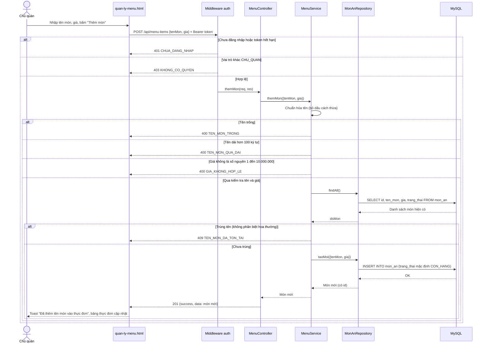
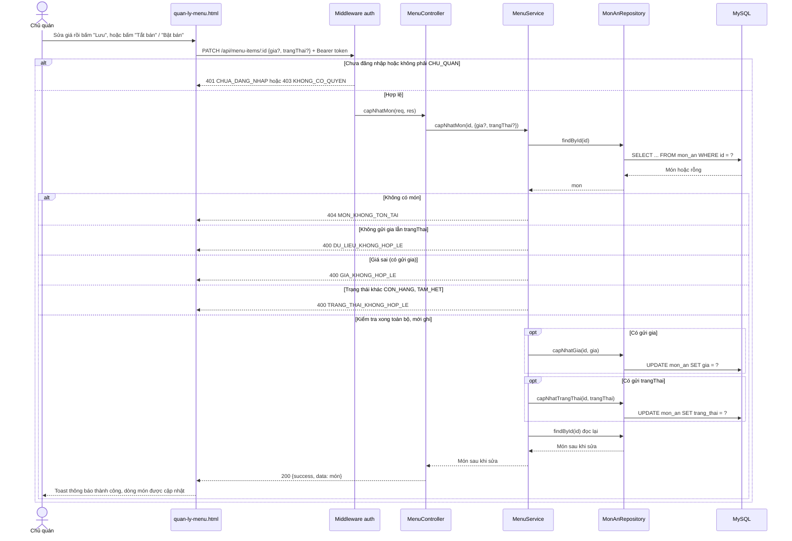

# Sequence Diagram – UC22 Quản lý menu

Người thực hiện: Chủ quán. Mọi request đi qua `verifyToken` (kiểm tra đăng nhập, 401) và `requireRole('CHU_QUAN')` (kiểm tra vai trò, 403) trước khi vào Controller. Tầng theo đúng code: Route → Controller → Service → Repository → MySQL.

Đối chiếu code: `src/routes/index.js`, `src/controllers/MenuController.js`, `src/services/MenuService.js`, `src/repositories/MonAnRepository.js`. Đối chiếu API: `docs/api-contract.md`, mục UC22.

## 1. Thêm món mới (`POST /api/menu-items`)

## 2. Sửa giá hoặc bật/tắt bán (`PATCH /api/menu-items/:id`)

Ghi chú: Service kiểm tra **hết** dữ liệu rồi mới ghi, nên không có trường hợp "sửa giá được nhưng trạng thái sai" làm dữ liệu bị sửa nửa chừng.
