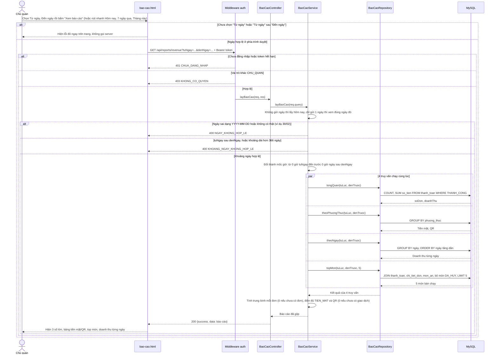

# Sequence Diagram – UC24 Báo cáo doanh thu

Người thực hiện: Chủ quán. Request đi qua `verifyToken` (401) và `requireRole('CHU_QUAN')` (403) trước khi vào Controller. Tầng theo đúng code: Route → Controller → Service → Repository → MySQL.

Đối chiếu code: `src/routes/index.js`, `src/controllers/BaoCaoController.js`, `src/services/BaoCaoService.js`, `src/repositories/BaoCaoRepository.js`, `src/public/js/bao-cao.js`. Đối chiếu API: `docs/api-contract.md`, mục UC24.

## Xem báo cáo theo khoảng ngày (`GET /api/reports/revenue`)

Ghi chú:
- Chỉ tính các giao dịch `thanh_toan` có trạng thái `THANH_CONG`. Món `DA_HUY` không được tính vào top món.
- Khoảng thời gian dùng mốc `>= tuLuc` và `< denTruoc`, nên **trọn cả ngày cuối** được tính, không bị mất giao dịch lúc 23:59.
- 4 truy vấn độc lập nên chạy song song (`Promise.all`) cho nhanh.
